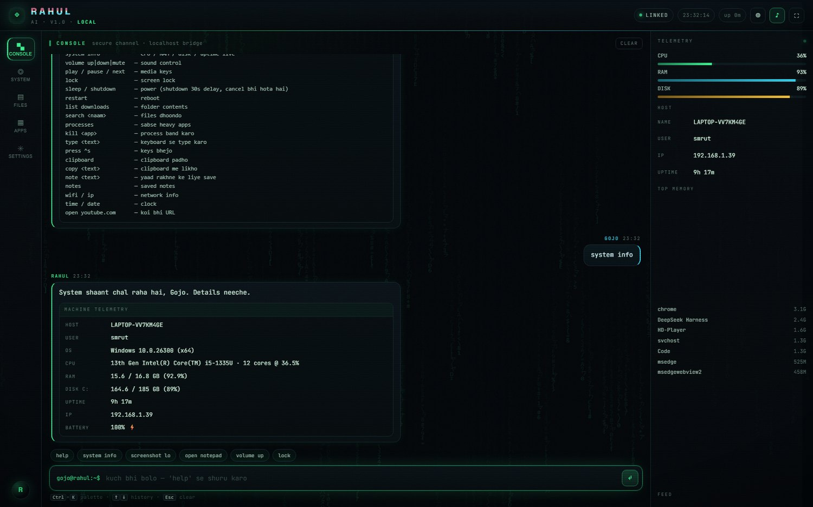
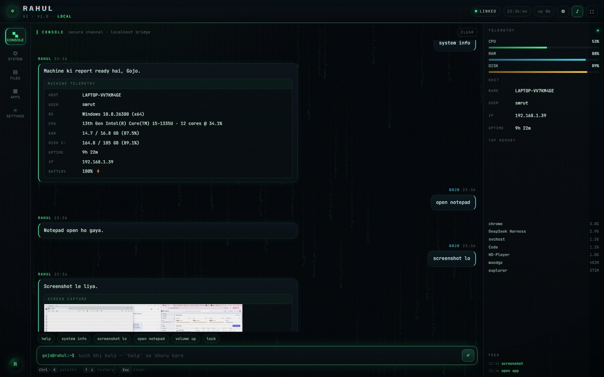
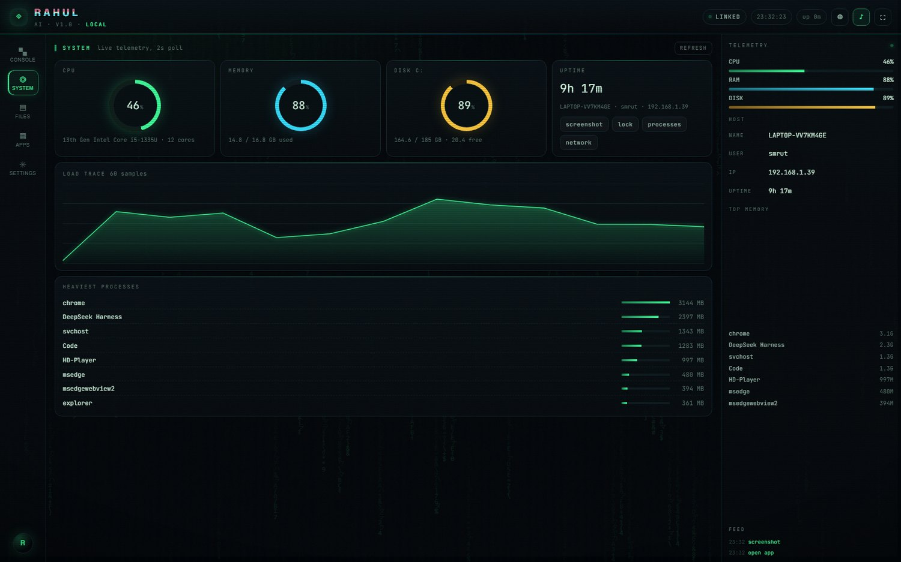
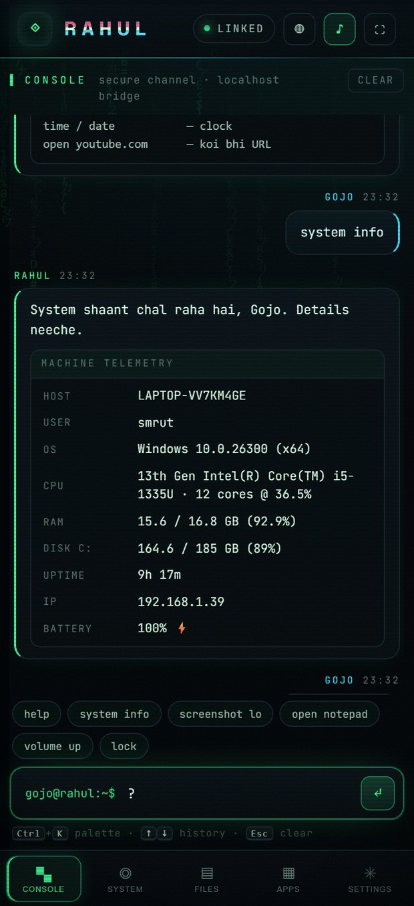
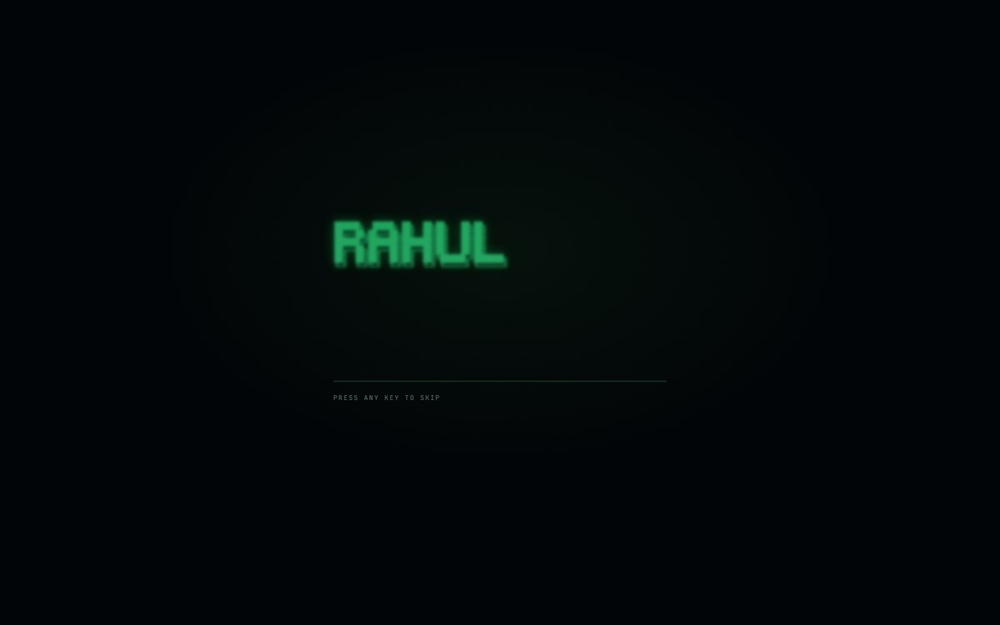

# RAHUL // gojo.os

A calm, local AI that actually **drives your Windows PC** — apps, volume, screenshots,
files, processes, power, typing, notes — wrapped in a terminal-neon interface that boots
like an operating system.

Not a chatbot demo. The web UI talks to a real Node bridge on `127.0.0.1` that runs
PowerShell against your machine, and it can start itself when Windows starts.



<table>
<tr>
<td width="50%"></td>
<td width="50%"></td>
</tr>
<tr>
<td></td>
<td></td>
</tr>
</table>

---

## 30-second start

```bash
cd rahul
npm start
```

The browser opens at **http://127.0.0.1:8787/** — no dependencies, no build step, Node 18+ only.

Want it to wake up with Windows?

```bash
npm run autostart:install     # adds a Startup shortcut
npm run autostart:remove      # undo
```

---

## What it can do

| Say this | What happens |
|---|---|
| `help` | full command matrix |
| `system info` | CPU / RAM / disk / uptime / battery, live |
| `open notepad` | launches notepad, calc, chrome, edge, code, spotify, settings… |
| `screenshot lo` | real screen capture, shown inside the chat |
| `volume up` / `volume mute` | media keys via Win32 |
| `play` / `next` | media transport keys |
| `lock` / `sleep` | workstation lock / suspend |
| `shutdown` (30 s, cancellable) · `restart` | power control |
| `list downloads` · `search invoice` | folder index + filename search |
| `processes` · `kill chrome` | task list / terminate (system processes refused) |
| `type hello` · `press ^s` | keyboard injection |
| `clipboard` · `copy some text` | clipboard read / write |
| `note call the bank` · `notes` | saved to `notes/notes.md` |
| `wifi` / `ip` | SSID, signal, adapter, IPv4 |
| `open youtube.com` | any URL in the default browser |

Rahul can also hold a normal conversation. Two ways, both wired:

**1. Local brain — free, unlimited, offline (default).** Uses [Ollama](https://ollama.com) on your own machine:

```bash
ollama pull qwen2.5:3b
npm start
```

`rahul.config.json` already points at it:

```json
"llm": { "base": "http://127.0.0.1:11434/v1", "model": "qwen2.5:3b", "key": "" }
```

No API key, no token limits, nothing leaves the PC. Slower than the cloud, and quality
scales with the model you pull (`qwen2.5:1.5b` for weak machines, `qwen2.5:7b` if you
have the RAM).

**2. Cloud API — faster, needs a key** (env wins over config):

```bash
setx RAHUL_API_KEY "sk-…"                              # OpenAI-compatible
setx RAHUL_BASE_URL "https://api.deepseek.com/v1"      # optional
setx RAHUL_MODEL "deepseek-chat"                       # optional
```

With neither, everything above still works — commands are matched locally, offline.

---

## How it fits together

```
┌──────────────────────────┐        token-guarded JSON         ┌────────────────────────┐
│  UI  (public/)           │  ───────────────────────────────▶ │  server.js             │
│  matrix · console · hud  │  ◀─── SSE telemetry every 2 s ───  │  127.0.0.1:8787        │
└──────────────────────────┘                                   └───────────┬────────────┘
                                                                           │
                                                        lib/brain.js  ─────┤ intent routing
                                                        lib/telemetry.js ──┤ cpu · ram · disk · procs
                                                        lib/pc.js  ────────┴─▶ PowerShell / Win32 / taskkill
```

* `public/` is a plain static app — that is exactly what Vercel serves.
* `server.js` is the bridge: static files, `/api/*`, SSE, screenshot gallery.
* `lib/ps1/*` are the only places that touch native Windows APIs.

---

## Deploy the UI on Vercel

The front end is static, so Vercel hosts it with zero configuration.

[](https://vercel.com/new/clone?repository-url=https://github.com/codexgojo-hash/rahul)

1. Push this repo to GitHub (already done for `codexgojo-hash/rahul`).
2. On [vercel.com/new](https://vercel.com/new) → **Import Git Repository** → pick `rahul`.
3. Framework preset **Other**, root `./`, build command empty, output `public` (already set in `vercel.json`).
4. Deploy. You get `https://rahul-….vercel.app`.

### Important, and honest

A hosted page **cannot reach `http://127.0.0.1` on your PC** — browsers block
`https → http://localhost` (mixed content), and Vercel has no access to your machine.
So the Vercel deployment runs in **CLOUD mode**: the full interface, the boot sequence,
the matrix, but demo telemetry and no PC control.

To drive the real PC from the Vercel page you need a tunnel with HTTPS:

```bash
# terminal 1
npm start

# terminal 2 (either one)
cloudflared tunnel --url http://127.0.0.1:8787
ngrok http 8787
```

Then open your Vercel URL and paste the tunnel URL **and** the token from
`rahul.token` into **Settings → Bridge → connect**. The page becomes a remote
control for that machine. Treat the tunnel URL as a password; close the tunnel
when you are done.

---

## Security model

* The bridge binds to `127.0.0.1` only — nothing is exposed to your LAN.
* Every `/api/*` call needs `x-rahul-token`, a 48-char random token created on first
  run and stored in `rahul.token` (git-ignored). The local page receives it via
  `/boot.js`.
* Shell access is **not** exposed. There is a fixed action list; `kill` refuses
  protected system processes; folders are an allowlist (home, desktop, documents,
  downloads, pictures, music, videos).
* For remote use, put the bridge behind a tunnel and stop the tunnel after.
* Shutdown and restart always use a delay (`shutdown /t 30`), so `cancel shutdown` works.

---

## Layout

```
rahul/
├── server.js              local bridge + static server
├── lib/
│   ├── brain.js           intent routing + persona + optional LLM
│   ├── pc.js              every OS capability, one function each
│   ├── telemetry.js       cpu / ram / disk / processes / battery
│   └── ps1/               volume · media · type · keys · clipboard · screenshot · wifi
├── public/
│   ├── index.html         boot screen, console, telemetry, palette
│   ├── assets/style.css   terminal-neon design system
│   ├── assets/app.js      matrix, sockets, chat renderer
│   ├── manifest.webmanifest · sw.js · icons
├── install/               autostart installer / uninstaller
└── vercel.json            static deploy config
```

---

## Notes

* Tests were run on Windows 11 (i5-1335U), Chrome 156, Node 24.
* Screenshots live in `shots/` and are git-ignored.
* Persona: calm, Hinglish-leaning, calls the owner **Gojo**. Change `rahul.config.json`
  to rename him and his owner.

MIT licensed.
